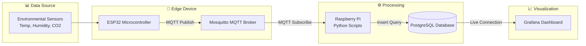

# Loco's Mycelium Lab

## Overview

This project implements an IoT-based monitoring solution for tracking mycelium growth parameters using sensor data collection, edge processing, and visualization.

This is a personal project that contains a starter kit to start a small scale gourmet mushroom farm using humidity, temperature and CO2 sensors using only a ESP32 and a Raspberry PI.

## What's Included

This repository contains:
- All collected data
- Code for ESP32 to collect and broadcast sensor data
- Python code to listen to ESP32 and place the data in a PostgresDB

## What's Not Included

This repository does not contain:
- How-to guide to:
  - setup a Raspberry Pi
  - setup Postgres
  - setup Grafana
- Grafana dashboards
- Hardware

## Architecture

## Components

### ESP32 Module
- Sensor data extraction
- MQTT message publishing
- Low-power operation

### Raspberry Pi
- MQTT broker
- Python data processing scripts
- Data standardization logic
- Database connectivity

### PostgreSQL
- Time-series sensor data storage
- Historical records management
- Query optimization for dashboard performance

### Grafana
- Real-time visualization
- Custom dashboards
- Alerting capabilities
