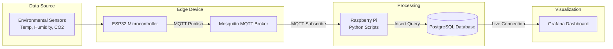

# Loco's Mycelium Lab

## Overview

This project implements an IoT-based monitoring solution for tracking mycelium growth parameters using sensor data collection, edge processing, and visualization.

This is a personal project that contains a starter kit to start a small scale gourmet mushroom farm using humidity (DHT22), temperature (DHT22) and CO2 (MH-Z19) sensors using only a ESP32 and a Raspberry PI.

## What's Included

This repository contains:
- All collected data
- Code for ESP32 to collect and broadcast sensor data
- Python code to listen to ESP32 and place the data in a PostgresDB

## What's Not Included

This repository does not contain:
- How-to guide to:
  - setup a Raspberry Pi
  - setup Postgres
  - setup Grafana
  - setup MQTT on Raspberry PI
  - open firewall ports
- Grafana dashboards
- Hardware

## Architecture

## Captured data
The following is an abstract of 10 rows of the captured data during a timeframe of ~3 months.

Event_time is in epoch, temperature = celsius, humidity = RH%, co2 = ppm.

| id | sensor_id | inserted_at | event_time | temperature | humidity | co2 |
|----|-----------|-------------|------------|-------------|----------|-----|
| 1 | 1000 | 2025-07-25 18:20:01.405482 | 1753460401809 | 25.2 | 67.2 | 624 |
| 2 | 1000 | 2025-07-25 18:20:06.451566 | 1753460406814 | 25.2 | 67.2 | 624 |
| 3 | 1000 | 2025-07-25 18:20:11.488546 | 1753460411819 | 25.2 | 67.2 | 623 |
| 4 | 1000 | 2025-07-25 18:20:16.527493 | 1753460416824 | 25.1 | 67.2 | 624 |
| 5 | 1000 | 2025-07-25 18:20:21.579142 | 1753460421829 | 25.2 | 67.2 | 624 |
| 6 | 1000 | 2025-07-25 18:20:26.640452 | 1753460426834 | 25.1 | 67.2 | 624 |
| 7 | 1000 | 2025-07-25 18:20:31.759591 | 1753460431839 | 25.2 | 67.3 | 624 |
| 8 | 1000 | 2025-07-25 18:20:36.706864 | 1753460436844 | 25.2 | 67.3 | 623 |
| 9 | 1000 | 2025-07-25 18:20:41.801695 | 1753460441849 | 25.1 | 67.3 | 623 |
| 10 | 1000 | 2025-07-25 18:20:46.831476 | 1753460446854 | 25.1 | 67.3 | 624 |

## Components

### ESP32 Module
- Sensor data extraction
- MQTT message publishing
- Low-power operation

### Raspberry Pi
- MQTT broker
- Python data processing scripts
- Data standardization logic
- Database connectivity

### PostgreSQL
- Time-series sensor data storage
- Historical records management
- Query optimization for dashboard performance

### Grafana
- Real-time visualization
- Custom dashboards
- Alerting capabilities
